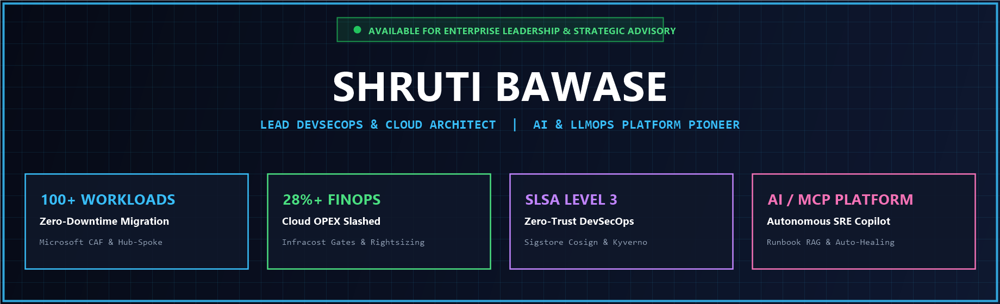
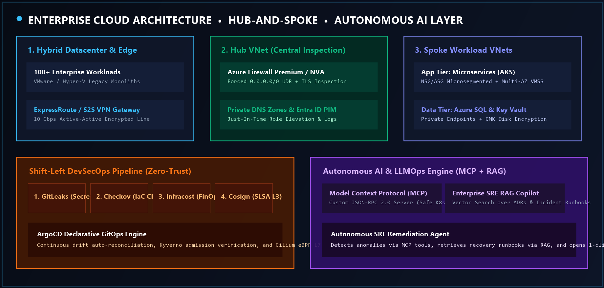

  <!-- ==================== HIGH-RES RETINA HERO BANNER ==================== -->
  

    

  <!-- ==================== ANIMATED DYNAMIC TYPEWRITER ==================== -->
  

    

  <!-- ==================== SOCIAL PILLS & CONNECT ==================== -->
  

    
    &nbsp;&nbsp;
    
    &nbsp;&nbsp;
    
  

---

### 💫 Welcome to My Digital Portfolio & Architecture Showcase

Hello! I am **Shruti Bawase**  — a **Lead DevSecOps Engineer & Enterprise Cloud Solutions Architect** with **3.3+ years** of intensive experience building zero-trust cloud platforms and pioneering autonomous AI systems.

- 🏗️ **Architected & Migrated 100+ Enterprise Workloads** from on-premises datacenters into Microsoft Azure with zero downtime.
- 🛡️ **Zero-Trust Supply Chain Security**: Enforced SLSA Level 3 compliance, Sigstore Cosign container signing, SBOM attestation, and Kyverno admission controls.
- 💰 **FinOps Champion**: Slashed cloud OPEX by **28%+** across multi-subscription environments using Infracost PR gates and DCR log tuning.
- 🤖 **Pioneered AI & LLMOps Infrastructure**: Built custom **Model Context Protocol (MCP)** servers, SRE RAG Copilots, and self-healing CI/CD agents, dropping MTTR by **65%**.

 

---

## 🚀 Flagship Production Repositories

<table width="100%">
  <tr>
    <td width="50%" valign="top">
      <h3>🏛️ <a href="https://github.com/shrutibawase/azure-enterprise-landing-zones">azure-enterprise-landing-zones</a></h3>
      
<b>Enterprise Cloud Landing Zones (CAF) in Terraform</b>

      <ul>
        <li><b>Dynamic Blocks:</b> Nested <code>security_rule</code>, UDR <code>route</code>, and VMSS extensions.</li>
        <li><b>Modularity:</b> Decoupled child modules with heavy <code>for_each</code> over complex <code>map(object)</code>.</li>
        <li><b>Zero-Trust:</b> Hub-and-Spoke with Azure Firewall Premium and Key Vault private endpoints.</li>
      </ul>
      

        
        
        
      

    </td>
    <td width="50%" valign="top">
      <h3>🤖 <a href="https://github.com/shrutibawase/agentic-devsecops-copilot">agentic-devsecops-copilot</a></h3>
      
<b>Autonomous AI DevSecOps & SRE Copilot Platform</b>

      <ul>
        <li><b>Model Context Protocol:</b> Custom JSON-RPC 2.0 MCP server for zero-leakage cluster queries.</li>
        <li><b>SRE RAG Engine:</b> Semantic search indexing post-mortems and KQL runbooks.</li>
        <li><b>Self-Healing Agent:</b> Auto-diagnoses OOMKilled/drifts and drafts 1-click merge pull requests.</li>
      </ul>
      

        
        
        
      

    </td>
  </tr>
  <tr>
    <td width="50%" valign="top">
      <h3>🔒 <a href="https://github.com/shrutibawase/zero-trust-k8s-gitops">zero-trust-k8s-gitops</a></h3>
      
<b>Kubernetes GitOps & SLSA Level 3 Supply Chain Security</b>

      <ul>
        <li><b>Cryptographic Signing:</b> Keyless OIDC container signing with <b>Sigstore Cosign</b>.</li>
        <li><b>Admission Control:</b> <b>Kyverno</b> policies enforcing non-root and verified signatures.</li>
        <li><b>Microsegmentation:</b> <b>Cilium eBPF</b> L7 default-deny ingress and egress policies.</li>
      </ul>
      

        
        
        
      

    </td>
    <td width="50%" valign="top">
      <h3>💰 <a href="https://github.com/shrutibawase/cloud-finops-sentinel">cloud-finops-sentinel</a></h3>
      
<b>Automated Cloud Waste Elimination & Rightsizing Sentinel</b>

      <ul>
        <li><b>Waste Reaper:</b> Detects orphaned managed disks, unassociated IPs, and idle gateways.</li>
        <li><b>Compute Rightsizing:</b> Analyzes 30-day P95/P99 CPU/RAM to downsize over-provisioned SKUs.</li>
        <li><b>Auto-Scheduler:</b> Shuts down non-prod instances off-hours, cutting compute by <b>65%</b>.</li>
      </ul>
      

        
        
        
      

    </td>
  </tr>
</table>

---

## 🏛️ Enterprise Cloud Architecture & AI Reasoning Blueprint

  

 

> **Architectural Highlights:**
> - **Transit Core:** ExpressRoute Active-Active connectivity terminating at a centralized **Hub VNet**.
> - **Zero-Trust Egress:** User Defined Routes (UDRs `0.0.0.0/0`) forcing all egress through **Azure Firewall Premium** with TLS inspection.
> - **Autonomous Reasoning Layer:** Custom **Model Context Protocol (MCP)** server providing safe cluster inspection to LLMs, retrieving verified runbooks via vector search, and dispatching self-healing PRs.

---

## 🛠️ Technology Arsenal & Skills

  

    
  

  

    
  

  

    
    
    
    
    
    
    
  

---

## 🐍 Contribution Velocity & Live GitHub Stats

  

 

  
  

---

## 📬 Let's Connect & Collaborate

Whether you are looking to **architect a zero-trust enterprise landing zone**, **execute an end-to-end cloud migration**, or **deploy autonomous AI SRE systems with Model Context Protocol (MCP)**, let's connect!

  
  &nbsp;&nbsp;
  

  <b>Shruti Bawase</b> &bull; Lead DevSecOps Engineer &amp; Enterprise Cloud Architect &bull; Powered by Zero-Trust &amp; Autonomous AI

