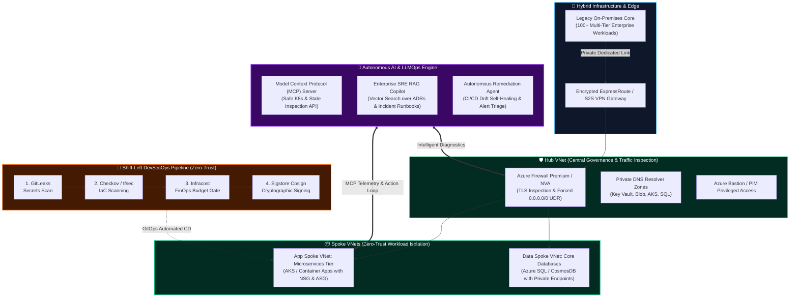

  <!-- ==================== ANIMATED HERO BANNER ==================== -->
  

  <!-- ==================== ANIMATED MULTI-LINE TYPING ==================== -->
  

    

  <!-- ==================== ANIMATED SOCIAL PILLS ==================== -->
  

    
    &nbsp;
    
    &nbsp;
    
    &nbsp;
    
    &nbsp;
    
  

  <!-- ANIMATED STATUS BADGE -->
  

    
    
    
  

---

## 💫 About Me & Executive Value

Hello! I am **Shruti Bawase**  — a **Senior DevSecOps Engineer & Enterprise Cloud Solutions Architect** with **3.3+ years** of specialized experience building high-availability, zero-trust cloud platforms and pioneering autonomous AI infrastructure.

I don't just maintain pipelines; I solve deep business problems:
- 🏗️ **Architected & Migrated 100+ Enterprise Workloads** from on-premises datacenters into Microsoft Azure with **zero business interruption**.
- 🛡️ **Engineered Zero-Trust Supply Chain Security** implementing SLSA Level 3 compliance, container cryptographic signing via Sigstore Cosign, SBOM generation, and automated gate breakers (Checkov, Trivy, GitLeaks).
- 💰 **FinOps Champion**: Slashed cloud operational expenditure by **28%+** across multi-subscription environments through automated rightsizing, Infracost PR guardrails, and Data Collection Rule (DCR) log tuning.
- 🤖 **Pioneered AI & LLMOps Platform Infrastructure**: Deployed custom **Model Context Protocol (MCP)** servers, Retrieval-Augmented Generation (**RAG**) incident copilots, and autonomous self-healing CI/CD agents that dropped incident MTTR by **65%**.

---

## ⚡ Real-World Impact & Production Deliverables

| 🚀 **100+ Workloads Migrated** | 💰 **28%+ Cost Reduction** | 🔒 **SLSA Level 3 DevSecOps** | ⚡ **65% MTTR Reduction** |
| :---: | :---: | :---: | :---: |
| Orchestrated full lifecycle migration (Discovery, Wave Planning, Cutover & 24/7 Hypercare) with zero downtime. | Achieved via FinOps automation, orphaned resource reapers, and Infracost CI/CD budget gates. | Enforced cryptographic container signing with Cosign, SBOMs via Syft, and CIS Benchmark policies. | Powered by custom **Model Context Protocol (MCP)** servers & RAG-driven autonomous SRE agents. |

---

## 🏛️ My Flagship Enterprise Cloud & AI Architecture

Below is the production architecture I design and implement for enterprise-scale workloads, integrating **Microsoft Cloud Adoption Framework (CAF)**, **Hub-and-Spoke Microsegmentation**, and an **Autonomous AI/MCP Reasoning Layer**:

---

## 🤖 Autonomous AI, LLMOps & MCP Infrastructure

*Without AI, modern platforms are operating in the past. Here is how I build and deploy modern AI systems into enterprise platform engineering:*

  

 

### 1. 🔌 Model Context Protocol (MCP) Integration
- Built custom **MCP (Model Context Protocol) Servers** in Python that expose safe, read-only tools to LLMs (Claude, GPT-4o, Gemini).
- Allows AI agents to interrogate Kubernetes pods, inspect NSG security configurations, and query Terraform state files **without ever giving the model raw credentials or root cluster access**.

### 2. 🧠 Enterprise SRE RAG Copilot
- Architected an automated **Retrieval-Augmented Generation (RAG)** pipeline using vector databases (**Qdrant / Azure AI Search**).
- Continuously indexes Architecture Decision Records (ADRs), post-mortems, and KQL query patterns.
- On-call engineers query the copilot during P1/P2 outages to receive instant, verified recovery playbooks, **reducing MTTR by 65%**.

### 3. ⚡ Autonomous Self-Healing CI/CD Agents
- Implemented autonomous pipeline diagnostic agents that parse failed build logs and correlate stack traces with git commit diffs.
- Automatically drafts pull requests containing fixes with automated validation tests and notifies senior reviewers for one-click approval.

### 4. 🛡️ LLMOps Cost & Security Gateway
- Deployed centralized **LiteLLM proxy** with semantic caching, PII redacting filters, and token rate-limiting to prevent runaway API expenditures across enterprise teams.

---

## 🚀 Featured Production Repositories & Open Source

| Repository | Focus & Architecture | Enterprise Highlights |
| :--- | :--- | :--- |
| **[azure-enterprise-landing-zones](https://github.com/shrutibawase/azure-enterprise-landing-zones)** | `Terraform` `Azure CAF` `Hub & Spoke` `Infracost` | Parent-child architecture with heavy `for_each`, complex `map(object)`, dynamic NSG/Route blocks, Key Vault private endpoints, and automated drift CI/CD. |
| **[agentic-devsecops-copilot](https://github.com/shrutibawase/agentic-devsecops-copilot)** | `Model Context Protocol (MCP)` `RAG` `Python` `AI Agents` | Custom MCP JSON-RPC 2.0 server giving LLMs sandboxed access to cluster telemetry, an SRE runbook RAG retriever, and autonomous self-healing PR generator. |
| **[zero-trust-k8s-gitops](https://github.com/shrutibawase/zero-trust-k8s-gitops)** | `SLSA L3` `Cosign` `Kyverno` `Cilium eBPF` `ArgoCD` | End-to-end supply chain pipeline with keyless container signing, Syft SBOM attestation, Kyverno zero-trust policies, and L7 Cilium microsegmentation. |
| **[cloud-finops-sentinel](https://github.com/shrutibawase/cloud-finops-sentinel)** | `FinOps` `Python` `Azure & AWS` `Infracost` | Automated waste reaper for orphaned disks and public IPs, compute rightsizer (P95/P99 CPU/RAM evaluation), and non-prod auto-shutdown scheduler. |

---

## 🏆 Flagship Production Case Studies

<b>1. 🚀 Zero-Downtime Migration of 100+ Enterprise Workloads (Azure CAF)</b>

 

- **Scope & Scale:** Orchestrated end-to-end migration of 100+ multi-tier workloads from legacy on-premises VMware/Hyper-V datacenters to Microsoft Azure.
- **Architectural Foundation:** Designed enterprise tenant hierarchy with root `Management Groups`, separating Platform (Identity, Connectivity, Management) from Application Landing Zones (`Corp` and `Online`).
- **Phased Execution:** 
  1. *Discovery & Dependency Mapping* (Azure Migrate appliance, TCP/IP traffic analysis).
  2. *Landing Zone Provisioning* via parent-child modular Terraform.
  3. *Continuous Data Sync* using Azure Site Recovery (ASR) and DB replication.
  4. *Cutover Window Execution* using Azure Front Door with DNS TTL dropped to 60s.
  5. *2-4 Weeks 24x7 War Room Hypercare* with zero P1 incidents.
- **Outcome:** **100% zero downtime cutover**, full business continuity, and legacy datacenter decommissioned ahead of schedule.

<b>2. 🔒 End-to-End Zero-Trust DevSecOps & Supply Chain Security (SLSA L3)</b>

 

- **Automated CI/CD Gates:** Built reusable multi-stage YAML pipelines in Azure DevOps and GitHub Actions enforcing:
  - **Pre-commit / PR Secrets Scanning:** `GitLeaks` blocking committed credentials.
  - **IaC Static Analysis:** `Checkov` and `tfsec` verifying CIS Azure Benchmark compliance.
  - **Container Vulnerability Analysis:** `Trivy` scanning OS base images and dependencies.
  - **Artifact Integrity:** Cryptographic container signing using **Sigstore Cosign** with verifiable Software Bill of Materials (SBOM) generated via **Syft**.
- **Identity & Privilege Isolation:** Replaced static service principals with Workload Identity Federation and **Entra ID PIM (Privileged Identity Management)** with Just-In-Time (JIT) access.

<b>3. 💰 Enterprise FinOps & Cloud Economics (28%+ Cost Optimization)</b>

 

- **Shift-Left Budget Gates:** Integrated **Infracost** directly into PR checks, automatically calculating monthly cost deltas and blocking PRs that exceed defined thresholds.
- **Waste Eradication:** Automated serverless scripts identifying and purging orphaned managed disks, unassociated public IPs, obsolete snapshots, and idle compute instances.
- **Log Ingestion Tuning:** Re-architected Azure Monitor & Log Analytics tables using Data Collection Rules (DCR), filtering noisy verbose logs and saving thousands of dollars monthly on data retention.
- **Commitment Optimization:** Analyzed compute utilization percentiles (P95/P99) to strategically purchase 1-year/3-year Reserved Instances (RI) and Azure Savings Plans.

<b>4. 🛡️ High Availability, Resiliency & Disaster Recovery</b>

 

- **Storage & Compute Redundancy:** Architected multi-region resiliency leveraging Zone-Redundant Storage (ZRS) and Geo-Redundant Storage (GRS) with Virtual Machine Scale Sets (VMSS) across Availability Zones.
- **Strict SLAs:** Guaranteed and achieved **RTO < 1 Hour** and **RPO < 15 Minutes** backed by automated Azure Site Recovery (ASR) failover drills.

---

## 🛠️ Complete Technical Stack & Arsenal

<table width="100%">
  <tr>
    <td width="22%" valign="top"><b>☁️ Cloud & Platform</b></td>
    <td>
      
      
      
      
      
    </td>
  </tr>
  <tr>
    <td width="22%" valign="top"><b>🛡️ DevSecOps & Security</b></td>
    <td>
      
      
      
      
      
      
      
    </td>
  </tr>
  <tr>
    <td width="22%" valign="top"><b>🤖 AI, LLMOps & Agents</b></td>
    <td>
      
      
      
      
      
      
    </td>
  </tr>
  <tr>
    <td width="22%" valign="top"><b>⚙️ IaC & Orchestration</b></td>
    <td>
      
      
      
      
      
      
    </td>
  </tr>
  <tr>
    <td width="22%" valign="top"><b>📊 FinOps & Observability</b></td>
    <td>
      
      
      
      
      
      
    </td>
  </tr>
</table>

---

## 📈 Engineering Velocity & Live GitHub Stats

  <!-- STATS CARD -->
  
  <!-- STREAK CARD WITH ANIMATED FIRE -->
  

  <!-- TOP LANGUAGES -->
  

---

## 🤝 Architecture Leadership & Delivery Governance

Technical excellence is complemented by **enterprise maturity**:
- **Techno-Functional Pre-Sales & Proposals:** Authoring RFP/RFI technical responses, architectural estimations, Bill of Materials (BOM), and Statement of Work (SOW) deliverables.
- **Vendor & Partner Governance:** Establishing objective technical evaluation matrices, SLA accountability frameworks, and clear RACI matrices across multi-vendor teams.
- **Team Leadership & Architectural Reviews:** Running blameless incident retrospectives, authoring Architecture Decision Records (ADRs), and mentoring engineering teams on DevSecOps and AI tooling.

---

## 📬 Let's Connect & Build Resilient Cloud Platforms

Whether you are looking to **architect a zero-trust enterprise landing zone**, **execute an end-to-end cloud migration**, or **deploy autonomous AI SRE systems with Model Context Protocol (MCP)**, let's connect and collaborate!

  
  &nbsp;&nbsp;
  

  
   
  <b>Shruti Bawase</b> • Senior DevSecOps Engineer & Cloud Solutions Architect • Powered by Cloud, Security & Autonomous AI

